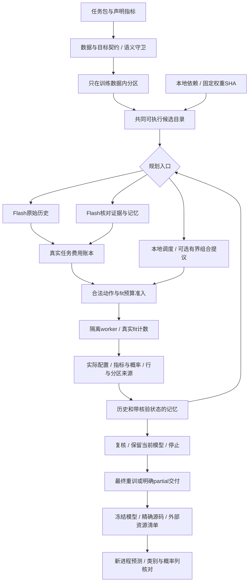

# 当前真正运行的Agent结构

这是实现与实测索引，不是未来愿望清单。默认本地策略；Flash为显式运行方式，optional结构不等于默认生效。

A93老师说明已澄清：通用预训练下游特征允许，由Agent自主选用；限制针对规划语言模型。环境入口默认auto，有固定资产时纳入共同菜单，restricted仍可做消融。具体原文见TEACHER_ENCODER_CLARIFICATION_20261122_zh.md，不将资源存在或任务名称直接当选模理由。

## 瓶颈、结构与证据边界

| 瓶颈 | 当前结构 | 已有证据 | 仍不能声称 |
|---|---|---|---|
| 搞错任务与标签含义 | TaskSpec、pair语义守卫、实际worker输入探针 | A66八格；A74正式对称/关系入口；A81真实偏好特征 | 任意自然语言任务都理解正确；独立48例仍缺 |
| 说的配置与真正训练对象不同 | 执行器目录与fitted estimator事实 | A67/A68作用域检查；新B方法真实worker执行 | 单靠方法名称就知道能力；所有自由文本都能核实 |
| 将不同试验/指标/划分的数字混用 | 行/标签/payload/score身份与comparison_scope | A61–A63概率反例；A67作用域；A72历史对象修复 | 机器核验等于独立语义真值；24回答独立标注仍缺 |
| 诊断后只有少数旧方法可试 | 合法方法目录、冻结编码器、有界组合工厂 | A76整合；A77正式组合提议5次实际完成；A81真实编码器 | 任意生成新算法代码；所有任务都会涨分 |
| 本机缺依赖使强方法静默消失 | 精确资产指纹、运行环境入口、菜单快照 | A82四文件原SHA一致；A83实际菜单；A84自主选MiniLM | 另一台电脑未配置资产也有同一目录 |
| 一次观测或到达顺序影响赢家 | 固定/动态调度、配对复核、incumbent；optional finalists | A69与B停止回放有负结果；A89六组在跑 | 动态或反馈必然胜过固定；finalists已证明普遍涨分 |
| 预算只数“方法次数”而没数内部成本 | worker真实classifier fit账本、refit预留、时间上限 | A74/A77/A81/A84物理计数；A87实际编码成本 | 有严格的时间最优保证；300秒绝不超时 |
| 模型保存后换进程无法使用 | 源码包v2、外部权重/版本清单、预测前校验 | A84真实自主模型；A86真实文本/视觉模型缺失/损坏拒绝 | 整个运行环境已经跨OS/机器位级复现 |
| 软件通过被当作性能/通用性 | 训练探针、同源目录对照、完整循环与未见任务分开 | A88两个已见任务目录收益，真实视觉候选被试但未胜出 | 两个开发划分已证明未知任务迁移；H仍封存 |

## 当前入口和默认边界

- 强环境统一入口：scripts.run_with_encoder_assets，资产登记runs/a82_encoder_assets，解释器来自A79覆盖环境。两类planner读取同一完整目录。
- 本地证据组合`--local-text-proposals evidence`默认off，仅local/ab-v1/full。它是确定性提议，不是Flash E反馈；旧B2实验与A70 Flash实验不可混叫。
- canonical偏好输出仅独立可选模块，未默认改变所有模型。ab-finalists、Flash候选覆盖、train profile、calibrated-v2与partial均按显式开关记录；新目录不自动晋级这些机制。
- 学校API请求失败不重试。旧未知账目保留，仅incremental-research继续有限研究；新增unknown/pending立即停，不声称课程总费用合规已核验。
- 强方法的正面开发迁移（B来源留出/Cornell）、A88同源菜单收益和未来H承担不同证据职责，不能相互替代。

代码已经通过执行验收与部分效果对照，当前重点是补完整同源Q/C1、独立标签，再冻结唯一最终规则进入H与最终任务交付；不为得到正面结果无限增加提示或种子。
