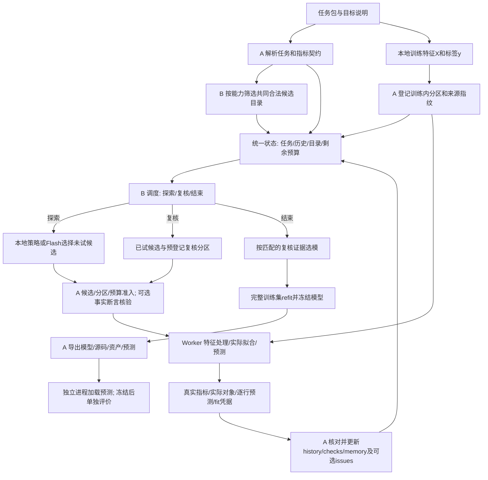

# SuperAgent A线工作交接给 DeepSeek

交接日期：2026-11-24（北京时间）。这是接续说明，不是要求重跑全部实验。用户因 Codex 额度即将用完而交接；项目仍可开发，没有宣布最终冻结。

## 0. 先读这一页：现在接哪里

我们做 **A线**：任务理解、标签与指标契约、事实和反馈核验、统一执行入口、预算与日志、模型预测交付。队友做 **B线**：方法库、较强候选、探索/复核/停止调度，并继续负责 H2 图像迁移和 Released Task2。A/B 是开发分工，不是两个运行时互相对话的大模型。

最新实验 **A145–A147 已完成**：事实引用和结构化核验已接入，受控纠错能发生，但动作效果没有稳定改善，而且新的协议更贵。因此 **不按原方案直接启动 A148 的 44 fit / 12 Flash 扩大实验，不把新机制升为默认**。下一步应先解决“纠正一个已知概念却浪费一次训练”的瓶颈。短程计划与自动续训尚未实现。

交接前正在完成用户的演讲材料：2分30秒讲稿、结构说明、瓶颈对应表、全项目数据流和处理流程图。已有保存的演示文稿及本地源文件，详情见第7节。先保证这些材料能被用户使用，再按第8节接续研发；不要为了补演讲数字重跑实验。

交接时的最新记录：**A累计1644次实际分类器拟合；共享账本387条请求；已知课程折算¥7.0165495；12条历史未知；0条待处理。** 这些是累计记录，不是本次交接消耗，也不是学校最终账单。最新owner回执记录 A 独占、空闲；开始付费前仍应核实是否有人随后启动任务。

本次整理交接文档、修改演讲材料：新增训练0、学校API调用0。

## 1. 工作目录、版本与优先阅读顺序

### 本机和Git

- 外层工作目录：`D:\codex\python_withai`。
- **当前共同代码仓库**：`D:\codex\python_withai\runs\integration`。不要把外层旧源码当最新源码。
- 远端：`https://github.com/limukun6/python_withai_superagent.git`。
- A分支：`codex/expanded-feedback`；不要默认从远端main开始。
- 本交接编辑前HEAD：`6b04f2d`（演讲初版）；实验结果提交：`500983f`。
- 最新实验生产源码固定于 `473ba84`，97个Python源文件；完整源SHA清单为 `research/a145_a146_grounded_pilot/production_freeze.json`。
- 本交接及结构版材料将随文档提交保存。拿到文件后运行 `git log -1 --oneline` 确认最终交接提交，不把473ba84误认为包含本说明的提交。
- 最近实验使用解释器：`D:\codex\python_withai\runs\a79_encoder_assets\venv\Scripts\python.exe`。根目录AGENTS中的`.venv`是早期基础环境；涉及编码器的实验优先核对前述实际环境及原runner依赖。
- 用户机器 RTX 5070 8GB；不要假设有第二块GPU。GPU重训练串行。

### 阅读顺序

1. 外层 `AGENTS.md` 和当前仓库 `AGENTS.md`。
2. `docs/CURRENT_AGENT_STATE.md` **从顶部读最新记录**。
3. `docs/EXPERIMENT_PROGRESS.md` 顶部的近期结果。
4. `docs/batches/A145_A147_grounded_protocol_results_20261124_zh.md`。
5. `presentation/ARCHITECTURE_AND_BOTTLENECKS_ZH.txt`。
6. `docs/A_LINE_NEXT_ARCHITECTURE_AND_EXPERIMENTS_20261124_zh.md`，注意顶部执行更新：其正文有开跑前的旧计数及设计，不全是已实现内容。
7. 总体目标看 `docs/nine_day_two_track_plan_20261120_zh.md`；接口历史看 `docs/AB_INTEGRATION_V1.md`。这些文档内的“未接入/等账本/未做H1”等旧段落不是当前状态。

最新事实 > 旧计划快照。不能把旧375/372/363/357请求副本当当前账本；不能因旧文档写“暂停”重新要求用户提供学校账单。尚未收到的新B进展，应检查其实际提交和结果，不猜测完成情况。

## 2. 用户偏好和课程边界

- 优先解决跨任务可复用的结构瓶颈，不只追某个任务的高分。
- 每个小批次**先保存计划、预算、可复跑代码，再运行**。失败原件不删，输出新目录，不覆盖历史结果。
- 每次汇报按“瓶颈 → 对应结构 → 做了什么实验 → 证据支持到哪一步”，列实际耗时、fit、API和费用。通俗解释，不只报实验编号。
- 两人都写代码、跑实验；A不能只审查B。可独立做的工作不要一直等队友。
- 原计划七天研发、两天准备演讲。没有确认具体截止日，不按聊天轮次自行推算今天必然是第几天。
- 语言模型限 Qwen/DeepSeek，当前运行时选 `DeepSeek-V4.1-Flash`。开发助手Codex/DeepSeek与运行时模型要分清。
- 老师已明确：下游分类可使用MiniLM等通用预训练模型作特征提取，但必须由SuperAgent按任务、数据和结果自主选择，不许为具体数据集预编排赢家。不要再要求用户重复问老师。
- 共同对照用相同候选、划分与预算；一般每路径最多 **11次实际分类器fit（含最终refit）/3次Flash**。组合、OOF内部拟合也计数；局部机制实验按各自预登记预算。
- 不访问未授权/未到评价阶段的外层和正式测试标签；已看过的开发/迁移集不能再称新未见任务。
- 用户长期授权在指定GitHub仓库同步工作；提交代码、说明和脱敏证据，不提交密钥、SQLite、原始数据、权重、缓存。

## 3. 整个系统怎么工作

运行时是一条统一实验循环。B控制“探索、复核或结束”；只有探索选择候选时，才由本地策略或可选Flash参与。A负责输入语义、执行准入、反馈依据与可交付输出。Flash不直接训练模型，也不能凭一句话宣布赢家。



数据边界：原始训练数组、标签、图片在本地；Flash收到任务摘要、合法候选、历史、预算及可选事实，不收到整份原始训练数据。外层与正式测试不回流搜索。AB入口实际使用带`ab_schema_version`的state字典；不要说每个入口都实例化通用benchmark的`DecisionState`类。

代码入口与职责：

| 层 | 主要文件/对象（仓库内） |
|---|---|
| 目标/指标与任务接入 | `superagent/contracts.py`、`task_goal.py`、`task_semantics.py`、`metrics.py`、`data.py` |
| 正式循环与分区登记 | `superagent/ab_run.py`、`cli.py` |
| 方法与调度（B为主） | `superagent/ab_catalog.py`、`ab_methods.py`、`ab_scheduler.py`及对应调度变体 |
| Flash上下文和提案 | `superagent/ab_flash.py` |
| 新事实协议与问题状态（A） | `superagent/fact_registry.py`、`grounded_proposal.py`、`grounding_issues.py` |
| 执行/实际fit准入 | `superagent/scheduler_bridge.py`、`executor.py`、`experiment_worker.py`、`fit_guard.py` |
| 配置与反馈 | `superagent/estimator_facts.py`、`hypothesis_memory.py`、`compact_feedback.py`及指标/作用域核验模块 |
| 选型与交付 | `superagent/ab_comparison.py`、`finalization.py`、`predict.py`、`partial_delivery.py`；`tools/export_model_bundle.py`、`recover_run_checkpoint.py` |

## 4. 针对哪些瓶颈，已做到什么程度

| 瓶颈 | 结构/方法与职责 | 当前边界 |
|---|---|---|
| 误读目标、正类、指标 | A任务/指标契约；未声明意图保留unknown | 已实现并有目标变换验收，不等于懂任意自然语言目标 |
| 一次生成且候选不足 | B共同可执行目录＋探索/复核/结束；A统一接入 | 已接，方法与调度收益不能全归A |
| 幻觉数值/配置、错读C、跨划分比较 | A作用域绑定事实＋结构化断言验证 | `grounded-v1`可选；自由因果解释仍未验证 |
| feedback只是warning，错误不关闭 | A结构化history/memory＋可选Issue状态 | 代码已接；真实完整执行后关闭仍待验证 |
| 上下文重复太多 | A可逆compact投影，不删unknown/失败 | 可选；仅小样本token改善，非普遍质量无损 |
| 少算内部fit、重置预算、失败重扣 | A实际fit/账本准入＋B预算调度 | 已有守卫；历史未知仍未知，不能宣传已核清总费用 |
| 单次涨分误当稳定优胜 | B复核选择＋A分区/证据契约 | 必须保持同划分配对和版本身份 |
| 中断或搬迁后不能交付 | A checkpoint、显式恢复、源码/资产绑定与隔离预测 | 能恢复交付；**不能自动续训/续搜** |

默认`strict-v1/full`没有因最近机制实验改掉。`grounded-v1`、compact、数值核、置信推理路由等均按相应开关与资格使用。L0是本地决策对照，**不是去掉所有A结构**：它仍有A的任务契约、分区、执行、预算与交付。

## 5. 已有证据：报告时允许讲到哪里

所有报告在`docs/batches/`；每批保留其原源码身份，不能拼成“最新97源全系统全部通过”。

| 批次 | 实测结果/资源 | 可以支持什么；不能支持什么 |
|---|---|---|
| A1-03 | 受控反馈验收4/9→9/9 | 模拟客户端＋真实worker的工程改进；非真实LLM质量提升 |
| A138 | 目标18/18；同数据四种目标变换共12fit、54.454秒、0API | 指标/正类/标签映射与交付一致；不是四个独立真实任务 |
| A139–A140 | full13157→compact12348输入token，−809/−6.149%；3任务固定状态各下一候选相同；9API、0fit、238.359秒、¥0.068634 | 降低这批输入开销；不能声称稳定省15.7%总费用或准确率无损。输入部分节费仅¥0.000809 |
| A141 | 9受控磁盘状态，6恢复/3正确拒绝，32行预测一致；新增fit/API均0 | 已有成果能重交付；非实际断电试验、非恢复训练。耗时看原回执，不编造节省多少小时 |
| A142–A144 | 新真实Banknote：L0/EC0各11fit，均280/280；共22fit/3Flash、¥0.032611；循环15.562/155.312秒 | 补充数值任务迁移/独立交付；无Flash提分，非普遍满分 |
| A145 | 55定向回归、7默认菜单一致；开发24/24，一次保留24/24；合法12/12、矛盾误确认0/6、未知误确认0/6 | 程序oracle下事实核验；不是独立人工语义金标准或自然错误率 |
| A146 | 三已见任务自然/受控×新旧共12Flash；新23条结构化断言核验、3受控问题明确纠正；726.625秒、¥0.162043 | 新问题状态为addressed_pending_check；真实语义修复重发0次，不称执行后resolved |
| A146成本 | 新旧各6回复，¥0.102702/¥0.059341，新多73.1%；等待424.623/300.875秒 | 新协议核验更明确但更贵，不是省费结构。旧组无新字段要求，不能说旧0/3纠错；旧Flowers也识别错误 |
| A147 | 两种不同动作×两分区，共8fit/92.547秒/0API；SMS新diagnose较旧improve均值−3.1840pp；Flowers+.625pp但两划分一负一正 | 改变动作不保证更好；没有稳定收益，不启动原A148，不推默认。不是完整Agent最终成绩 |
| A130–A132 H1 | 两组对称文本迁移55.36→58.35%、55.25→60.00%；付费阶段22fit/6Flash/¥0.041814 | 该任务共同目录下Flash选择路线有价值；非A的checked/grounded独立收益，非普遍任务规律 |
| A135 Released Task1 | 原92源11fit、88.578秒；已知验证1523/2030=75.0246%；2030行三种交付一致 | 旧源交付候选，可引用但不是新97源交付/本轮提分；正式test未读 |

重要纠偏：A146旧prose检查器两处“矛盾”经上下文复查为疑似其它分类器引用误报，原结果保留；不要宣传“新结构消除了两条真实推理错误”。四个同动作配对未重复训练，不能将跳过数量直接换算成实测省费。

结果入口：

- `docs/batches/A145_A147_grounded_protocol_results_20261124_zh.md`
- `docs/batches/A139_A140_compact_feedback_results_20261124_zh.md`
- `docs/batches/A141_interruption_recovery_results_20261124_zh.md`
- `docs/batches/A138_goal_robustness_results_20261124_zh.md`
- `docs/batches/A142_A144_new_numeric_transfer_results_20261124_zh.md`
- `docs/batches/A130_A132_H1_paid_results_20261123_zh.md`
- `docs/batches/A133_A135_routing_and_task1_results_20261123_zh.md`
- 最新原始脱敏证据：`research/a145_a146_grounded_pilot/`和`research/a147_grounded_action_followup/`。

## 6. 账本、网络、预算和本机私有资产

**唯一当前真实账本**：

`D:\codex\python_withai\runs\a129_B_ledger_return\private\ledger.sqlite`

最近owner回执：`research/a145_a146_grounded_pilot/paid/current_ledger_owner.json`。

交接记录SHA-256：`5b1f5c5825f15cf139252626d00d838c7a6fe1403fd0c4c9b50366ad512d82db`。

用户已授权原12条未知不等学校官网对账继续研究，原值保持null，按已有ID/原行SHA接纳清单启用。**不是允许删除未知、算成0或绕过账本。新增unknown/pending仍停止本轮付费，失败不自动重试。** A/B不能同时写同一账本；移交先停队列、核哈希和累计记录，再转owner，不把JSON摘要当SQLite。

学校API：`https://aigc-api.hkust-gz.edu.cn/api/v2/chat/completions`，模型`DeepSeek-V4.1-Flash`，timeout=60。不用旧名`DeepSeek-V4.1-Flash-1017`。密钥只从现有ignored `api_key.txt`读取，不输出，不写文档或命令参数正文。

校园接口直连，不更改系统代理/防火墙。已有`scripts/campus_direct.py`可显式用于官方域名到10.121.10.250的进程内解析，保持HTTPS Host/SNI/证书；按已有runner协议用，不自动切换重试。Codex沙箱DNS/10013或代理虚拟IP不等于学校服务失败，实际网络任务需正确执行权限。DeepSeek本身不能本地执行时，让用户跑已保存脚本并交回completion，不假称已运行。

老师许可、旧未知继续授权不需要重新确认。新批次先写上限；计划中的阈值是估计预留/usage结算停止阈值，不保证平台扣费上限。已知¥7.0165495不含12条未知，最终平台扣费仍不知。

Git不包含私有数据、模型、编码器缓存、账本、密钥。换电脑只clone代码不够：从对应批次protocol/receipt找本机输入和SHA，确认合法资产到位。不能新建空账本、下载替代数据后冒称同一划分。没有这些资产时仍可做代码、计划和文稿工作。

## 7. 演讲和结构图交接

用户要求2.5分钟演讲稿＋PPT或网页，评分口头4/视觉3/系统与实验理解5；随后明确要求讲清瓶颈对应结构和完整数据/处理流程。

已有同一份保存的Spaces演示：`page_eaad92b193048191a12e0df2303c4031`，artifactRef为`artifact_external_b7996b1d-877d-4800-b87b-6507023f2f3b`。**5页主讲＋5页隐藏附页**，主讲35/35/30/25/25秒，共150秒，约609汉字另有少量英文，实际需朗读校准。10页已经渲染检查；图表和表格为可编辑原生对象。

本地材料（均在仓库`presentation/`）：

- `A_LINE_2M30_SCRIPT_ZH.txt`：逐页讲稿、技术问答、证据来源。
- `ARCHITECTURE_AND_BOTTLENECKS_ZH.txt`：8项瓶颈、职责、代码、数据流、处理流程、默认/可选/待实现边界。
- `project-data-flow.mmd`、`project-control-flow.mmd`：可编辑流程图源。
- `build_a_line_deck.mjs`：初版构建器；`revise_architecture.mjs`：结构修订器。
- `delivery_manifest.json`：页面ID、时长、SHA和检查记录；`README.txt`：维护方式。

主讲页1全项目数据与证据回路；页2瓶颈→结构→行为；页3探索/复核/结束/纠错/异常处理；页4分项实证；页5负结果与取舍。附页9详细数据边界，附页10代码映射，另保留问答、来源和原成本图。

DeepSeek通常没有Codex的Spaces编辑工具。**不要把`.mjs`当普通Node脚本就声称生成PPT**：它依赖Artifact Session。用户可从现有查看器导出PPTX后交给你编辑；也可依据本地稿和Mermaid源制作离线网页/PPT。当前没有额外本地PPTX，不能声称Git里已有成品PPT文件。不需要学校API来制作幻灯片。

若继续编辑现有云文稿，原位更新；`revise`的notes阶段需要`input.sources`、`input.architecture`，可选`input.qa`。初版builder的notes接口不同，不要用旧notes覆盖新版稿。主讲不塞满所有工程细节，附页供问答；同时保留负结果和证据边界。

## 8. 下一步可独立推进的工作：建议约5小时

这是交接后的建议顺序，**尚未执行，不是新增实验已获结论**。先做A能独立完成的内容，不等B的H2。

### 0:00–0:30 接续与材料检查

核Git分支、生产SHA、最新completion和唯一ledger owner；确认无旧队列在跑。读本交接和当前状态，修正任何版本/路径差异。确认用户能打开讲稿和结构图；无需重建全部演示文稿。耗时是人工工作估计，0fit/0API。

### 0:30–1:45 首选改动：将“知识纠正”与“执行修复”分层

问题来自A147：错误C定义可以根据配置和定义核清，但新提案选diagnose重新训练，短期结果低于原improve。**这提示资源错配，不足以证明所有诊断都应禁用。**

先另存新批次计划和测试runner，读取当前Issue接口后设计兼容字段/分类，名称以实际代码为准：

- 知识/引用类：错数字、已知参数定义、任务类型、跨作用域引用；正确引用现存事实即可核实其语义修正，不强制新fit。
- 实现/执行类：实际对象不符、运行失败、必须靠执行确认的后置条件；保持待执行，不用一句“已纠正”关闭。
- 测量/假说类：是否提分、是否稳健、因果解释；没有新测量或对应证据就维持unknown/pending，不能自动certify。

把“语义已修正”和“训练表现是否改善”分开记录。继续由B调度决定explore/confirm/stop，探索仍由原本地/Flash选择；不要悄悄替模型改候选、不按SMS等数据集名路由、不禁掉所有diagnose。默认行为先不改。

### 1:45–2:45 零训练/零API验收与历史回放

先登记小型开发案例与独立保留案例：已知定义、不足证据、跨run/split引用、真实执行失败、测量待证、错误关闭、预算不足、网络失败等。开发集可迭代；保留组固定后只评一次。保留例由程序构造时如实称工程oracle，别称人工金标准。

回放已封存A146响应，检查知识纠正是否不再必需fit、执行问题是否仍pending、unknown是否误关、候选菜单/默认策略是否漂移。**回放不是新LLM实验，不能计算自然错误率或新的线上节费。** 输出protocol/results/completion及负例原件。

### 2:45–3:45 条件小试：先验证真实闭环，不直接上大矩阵

只有前一阶段通过、源与预算先冻结，才另写真实小试计划和runner。建议第一批最多两条路径、每条最多3次实际fit（含refit）、3次Flash；合计上限6fit/6调用。采用受支持匿名小任务或训练内开发数据，记录新旧候选/分区一致性；没有数据质量问题不要换seed追收益。此上限是新建议，**不是已经运行的A148**。

验收目标：从正式入口启动，无人中途选候选；事实→提案→执行→真实反馈→问题状态→重训→独立进程预测能串起来。为当前源码单独记录source SHA，禁止用旧92/94源模型冒充验收。阶段首先证明工程闭环，不据一个小任务宣称提分。

历史参考：A146每调用平均约60.6秒，A147每fit平均约11.6秒，但任务、缓存、模型不同。小试预留30–60分钟，首次路径后按实测校准，不把过去均值当保证。运行失败停止该付费批，保存错误，不自动重试。

### 3:45–5:00 分析、报告与交付

列语义纠正通过率、错误关闭数、pending保留数、动作变化、实际fit/API/输入输出token/费用/耗时；模型效果和解释正确性分开。与历史结果同输入回放可作机制比较，但因源码/协议不同不得伪装预登记线上对照。

如无正信号或明显加费，保留可选并报告负结果。只有改进有依据且剩余时间允许，再设计同任务/同候选/同划分/同fit预算的正式新旧对照；不要沿用当前被停的A148方案直接开跑。更新当前状态、进度和演讲证据，提交代码及脱敏结果。

更后面的条件方向：A149短程计划片段（每步按新证据检查失效，B停止优先）；A150幂等安全续跑（继承预算/账本、避免重复fit/API）。二者都尚未实现，不能称A141已覆盖，也不要同时开三个大功能。

## 9. 已保存脚本和安全接手命令

以下命令只确认状态，不触发训练/API：

```powershell
Set-Location -LiteralPath 'D:\codex\python_withai\runs\integration'
$py = 'D:\codex\python_withai\runs\a79_encoder_assets\venv\Scripts\python.exe'
git status --short
git branch --show-current
git log -5 --oneline
Get-Content -LiteralPath '.\docs\CURRENT_AGENT_STATE.md' -Encoding UTF8 -TotalCount 35
Get-Content -LiteralPath '.\research\a145_a146_grounded_pilot\paid\current_ledger_owner.json' -Encoding UTF8
Get-FileHash -LiteralPath 'D:\codex\python_withai\runs\a129_B_ledger_return\private\ledger.sqlite' -Algorithm SHA256
& $py -m superagent --help
```

路径含空格或中文时完整加引号；PowerShell `-File`后必须有脚本路径，不用反斜杠续行。若写含中文的Windows PowerShell 5脚本，注意UTF-8 BOM/编码，不把`学校`读成乱码。不要输出密钥来排障。

已完成批次的runner（用于理解和有明确需要时复现，不是接手后全跑一遍）：

| 功能 | 脚本模块 |
|---|---|
| A145开发案例/核验 | `scripts.prepare_a145_grounding_cases`、`scripts.run_a145_grounding_verification`、`scripts.evaluate_a145_grounding_cases` |
| A146冻结输入/真实请求/评分 | `scripts.prepare_a146_grounding_pilot`、`scripts.run_a146_grounding_pilot`、`scripts.evaluate_a146_grounding_pilot` |
| A147动作跟进 | `scripts.run_a147_next_action_followup` |
| 汇总与归档 | `scripts.archive_a145_a146`、`scripts.finalize_a145_a147_evidence` |
| compact机制与评价 | `scripts.run_a140_flash_projection`、`scripts.evaluate_a140_flash_projection` |
| 中断交付工程 | `scripts.run_a141_interruption_recovery`、`tools.recover_run_checkpoint` |

真实参数从相应`protocol.json`、批次计划和runner读取；新运行写新目录。不要给用户一条指向已存在输出目录的“继续”命令，导致覆盖或重复付费；不要重评已封存保留例后再调规则。

## 10. 与B协作及最后检查

B已交过独立48案例/24标注以及多批旧对照，不能再声称一直未交：48例原45/48，其中4例样本数与准确率不相容；有效原例41/44，事后修订4/4分别保留。24标注由B侧一名Codex完成，非人工独立金标准，事实项6明确错/8未发现/10证据不足。这些与A145程序oracle不是同一套样本，分母不能相加。

B数值核已由A137可选接入；置信推理路由已可选接入；弱标签未过B门槛未接。H1已完成，不再等合法对称方法；H2/ReleasedTask2仍由B负责，最新完成与否需查看真实提交。B本地开发可并行；共同实验冻结只固定那一批源码/目录/划分，不等于要求B停止所有开发。

接手完成的最低交付：

1. 用一段话复述当前版本与任务，不重开已经完成的批次。
2. 新批次先有计划、runner、预算与可中断记录，再开始执行。
3. 每条结论可追溯到结果文件、源码身份和适用范围。
4. 不更改旧未知账目、不误用旧ledger、不覆盖旧证据。
5. 主动报告真实进度与失败；无法访问本机/云文稿时明确说明，给可运行脚本，不编造完成。

可以直接给DeepSeek的启动语：**“请先读这份交接和docs/CURRENT_AGENT_STATE.md，核对本机与Git状态，保留现有默认。先接好演讲材料，再按第8节优先实现知识纠正与执行修复分层；每批先落盘计划和可复跑代码。不要直接开A148，不要重复已完成的付费实验。报告按瓶颈、结构、实验、证据边界，并列实际资源。”**
