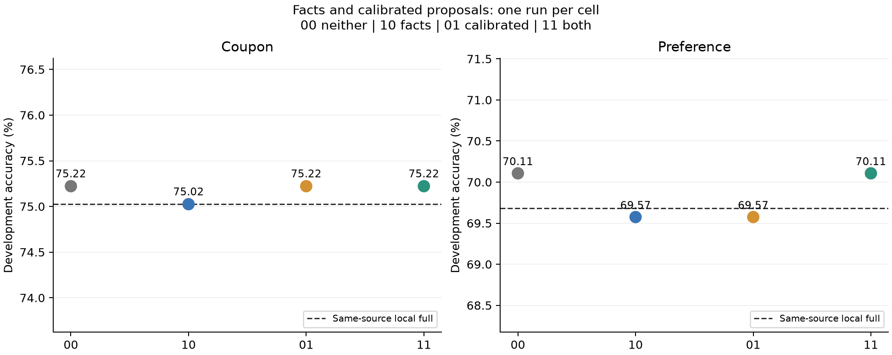

# 本轮研发结果：事实、反馈、选模与模型交付

本轮是研发实验，不是最终答辩/正式提交版。原23:24–02:24窗口在00:21因Windows待机中断；08:32恢复后另外记录恢复窗口，待机不算正常训练时间。A32保留8完整/1部分/11未启动，未开其外层val；旧A34/A35/A36/A38没有执行，不能用新编号顶替为完成。后续Agent生产源码保持本轮1319e5c对应的同一内容，所有真实路径中途不改方法或人工选模。

## 1. 数据事实不能只留在本地

**瓶颈**：原AB输入有任务类型、目标和结果，却没有训练类别分布、缺失/长度、图像形状等已有摘要。

**结构**：--task-profile train将训练内聚合事实接正式state与两类提示；raw/E获得相同事实，不传原样本、路径或任务名，长列统计按明确规则截断。默认off保留旧行为。

**实验与证据**：五真实开发任务摘要/完整入口/故障交付验收通过；24旧默认请求逐项重建相同，24新公共上下文对相同。两次验收发现摘要变量覆盖、checkpoint字段假定错误，已修复并保留3+5次实际训练，不能从资源里删掉。

## 2. 允许不知道，仍不代表会选得更好

**瓶颈**：strict-v1要求每次承诺数值涨分，诊断动作也被迫写正向预期。

**结构**：calibrated-v2允许purpose/uncertainty，数值预期可null或声明增/降，证据/配置/预算核验不放宽；null记not_stated，不能记成支持。这是诚实预期契约，**不是统计置信度已校准**。

**A50真实2×2**：同候选、划分、源代码、11fit/3调用上限，raw动态闭环；8模型全部封存后统一指定val评价。

| 开关 | Coupon accuracy /2030行 | 偏好accuracy /940行 |
|---|---:|---:|
| 00 原输入+原契约 | 75.22% | 70.11% |
| 10 加训练事实 | 75.02% | 69.57% |
| 01 仅新契约 | 75.22% | 69.57% |
| 11 两项都开 | 75.22% | 70.11% |

85实际fit、24真实调用、2198.880秒、105307输入/18464输出token、课程计价¥.179163。12个新契约提案全部选择数值预期未知；行为改变，但没有稳定最终涨分。四格每格只有一次运行，不做显著性、稳定交互或普遍有效声明。

**A51跨输入联合补充**：SMS off/on均macro-F1 .945980（826行），照片均accuracy .975（80行）。32fit、12调用、约353秒、¥.092121；这是联合结构在两已见任务上的结果，不能分拆因果或称unseen。

## 3. 反馈可能改善局部选择，却未必改善最终交付

**A55同历史新R/E**：两任务各三个冻结状态，新问R/E各一次；除checks/memory外输入逐项相同，顺序交替。12新调用、71069输入/14887输出token、¥.130617，问答278.387秒。原R→新R的候选选择6/6相同，仅说明这六例，不能说模型从不波动。

全部回答封存后，在两个新训练内group划分评价动作：24逻辑评价去重成18实际fit，301.672秒。Coupon三个状态R/E完全相同；偏好E转向word_char，在三个状态上平均分别高2.59、2.20、2.44个百分点。多个前缀来自同一任务，两个新划分不是两个新数据集。

**A58放回完整闭环**：只对有局部信号的偏好做探索性follow-up，新跑E，复用A50同源R11参考，初始公共提示相同，后续各自自主发展。E 69.57% vs R 70.11%，33行预测不同、净少对5行；10新fit、3新调用、113.735秒、21537输入/3206输出token、¥.034361。没有重跑R，不能称新成对重复试验。

**真正暴露的结构问题**：R最终word_char C=.05有primary+confirmation_1；E最终C=.1只有primary。当前规则给最初三方案的赢家默认incumbent地位，后来挑战者则要更多证据才能替换；最终赢家的复核门槛不一致。它是值得修复的机制，但不能因此断言这就造成了外层5行差异。

**A59只读诊断**：E的C=.1在同primary领先C=.05约1.02pp，按1221文本组/1659行事后配对重采样2000次，区间约[+0.18,+1.92]pp，未含0。这个结果不能被改写成“主划分领先只是行采样噪声”；它不包含训练波动、选择后偏差和分布变化，也不能保证外层领先。下一批应测试统一finalist复核，而非只加一个置信区间。

**A53另一个反例**：新契约单开在偏好首动作的新划分均值更好，但端到端最终反而较低。8首动作×2划分=16逻辑评价，去重6fit/92.895秒/0API。一次好建议不能替代全程探索与选模。

## 4. 方法能力和计算预算仍是主要上限

**A47同源方法库Q**：五任务7物理路径（相同目录去重），67fit/328.799秒/0API，七模型重载通过。

| 任务 | baseline/full候选 | 结果 |
|---|---:|---|
| Coupon | 14/15 | .738916→.750246，+1.133pp；10→11fit |
| 照片 | 7/8 | .975→.975；10→9fit，3行预测不同 |
| 偏好 | 22/22 | 同一目录shared一次，accuracy .696809 |
| SMS | 6/6 | shared一次，macro-F1 .945980 |
| Bean | 5/5 | shared一次，accuracy .913223 |

增加候选库在当前Coupon划分有收益，不是字段特征的独立因果证明；另三任务未激活新增方法，不能说做过独立扩展对照。偏好22候选只有4个词字符路线，数量不等于强方法广度。

**耗时**：Coupon原Flash路径约499秒，API延迟仅41.9秒，内部评价worker约401.2秒，另有最终训练/启动/日志。不能把全部慢都归因网络。相同11次训练，本地full约81秒、Flash约499秒；选择不同深度/路线的成本差异很大。分解见research/a50_facts_calibration/runtime_costs.json，余项不冒称纯API开销。

## 5. 失败恢复和真正独立交付已落地

--partial-delivery checkpoint异常后核验已成功模型/训练账本/同划分证据，零新训练和调用生成partial；仍failed、exit2、requested_planner_completed=false。五真实任务各一次完整3fit和人工故障2fit，共25fit/142.736秒；十模型搬迁预测一致。另1合法恢复/6损坏或缺失证据拒绝，0fit。模拟SSE三用例9fit/5mock/26.946秒，0真实API，真实ledger未改。不能把人工故障叫真实网络恢复实证。

A52固定四个联合新结构Flash模型搬迁通过。A54五个full目录模型+一个partial导成六个源码自包含zip，隔离源预测一致；A57在独立venv、不共享site-packages、从PyPI重装锁定依赖后，六包预测仍逐字节一致，安装160.346秒/全批169.709秒，0fit/API。原环境未改。它证明同一Windows/Python上的新依赖环境，不等于跨系统/硬件验证。模型包在主仓库runs/a54_selfcontained_delivery，各task/model_bundle.zip，二进制不进Git。

A56修复旧B导出器与正式AB格式脱节；五任务/partial/匿名共7终态快照返回stop，损坏证据拒绝；另提供真实匿名决策时刻和B explore动作例子。examples/ab_v2供适配，均标fixture/replay，不可当真实剩余额度继续收费。

A49实际参数读取原型五模型/五错误声明识别通过，0自然冲突；尚未接生产，不能说当前所有超参都由拟合对象全面核验。

## 6. 资源、版本与边界

从本轮窗口起点597跟踪fit到970，新增**373次实际fit调用**（含失败验收与回归），不是全项目/队友总数。新增72聊天尝试记录＝71成功响应+1严格审计未发出的DNS失败；330073输入/67439输出token，已知新增课程计价**¥.599829**。账本现275记录、已知5.9765785元、原11unknown、pending0、无新增unknown。真实平台扣费与课程总预算仍未核验，未重建空账本。只读models GET不混成聊天调用。

最终124项旧回归通过，实际7fit；新合同21项通过0fit。资源逐批对应原始物理观察器与持久票据，见research/a50_a59_final_round/resource_audit.json；Git规范化LF后用canonical_value_sha256核验JSON值，原字节SHA仍指运行当时文件。

H1/H2和正式test未开。完整最终同版Q/C1/H、AUC正式入口支持、新强方法合法性/权重/计数、最终全局部署策略仍待后续。当前能证明跨类型工程能力和若干开发任务现象，**不能声称通用准确率突破已经完成**。
