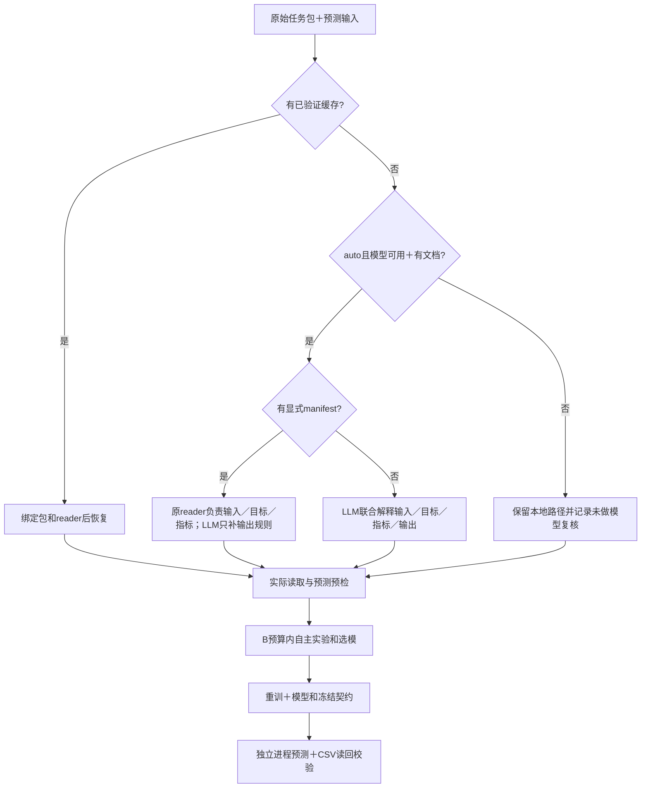

# SA16：CLI自动理解输出，避免“输入能读就算完成”

基线b620b83。A修改语义入口/CLI和兼容保护，不改B方法、排名或最终选模规则。

## 瓶颈 → 结构 → 实验 → 支持范围

| 瓶颈 | 结构 | 证据 |
|---|---|---|
| 原生reader成功只证明输入可读，输出要求可能根本没进系统 | 人用CLI默认auto：有模型client且有文档则自动联合解释；显式manifest只允许输出overlay | 改前两个开发微案例输入均可读、输出完整0/2；改后用开发者模拟回复2/2。另有1条正式真实Flash交付通过 |
| 依赖用户手动知道要加proactive | root train/solve和superagent unified parser默认auto，并贯通到训练子进程 | 实际裸solve无解释/开题覆盖，run_manifest记录auto，日志选proactive，LLM首次输出overlay通过 |
| 自动模式可能覆盖机器声明或破坏旧实验 | manifest输入保持权威；显式fallback/proactive和程序化API旧默认保留；legacy归旧路线 | 13项新兼容/行为检查，含输入覆盖拒绝、缓存不初始化client、两个parser、无文档/无client、blocked/耗尽、预检失败、共享预算 |
| 把模型未复核当作理解完成 | 无client/无文档时日志说明本地路径；已配置client预检失败时记录未完成，blocked/耗尽不静默补全 | 回归检查明确覆盖，仍不能把离线fallback称作模型复核通过 |

完整相关检查**274/274，13.063秒，0fit/0API**（13新＋原261；两条旧Dummy.fit夹具仍排除）。原基线在改代码前封存research/sa16_local_baseline_01，不能事后改成功。



## 正式真实运行

使用SA14已用Iris开发行重封装为标准CSV和显式manifest（96训练/24预测）。manifest只写输入/目标/balanced_accuracy；原文另要求管道分隔、UTF-8 BOM、Case保留record_id前导零、Result映射0/1/2→c0/c1/c2、ScoreFor2为训练类2概率。新封装不是独立新任务，未提供或读取预测标签。

同一原包在显式fallback下本地输入可读，但没有output_recipe。新版standalone `python -m unified_agent solve`不加解释或开题覆盖，stdin关闭，没有注入模型/工具/算法/oracle。auto从原文取得semantic-output-v1；第一次回复就通过。B默认Flash决策选RandomForest，实际2次训练含refit，完整导出24行。

外部9项契约检查全部通过。独立审计核对：manifest原X/y/input_schema/metric全部不变；原ID、类别映射、指定类概率、BOM/分隔符/行序成立；实际usage对应canonical两行；有后续B规划时显式迁移仍绑定语义请求；新进程CSV逐字节相同。审计新增0fit/0API，账本不变。

| 角色 | 输入token | 输出token | 课程费用 |
|---|---:|---:|---:|
| 自动语义解释 | 1473 | 421 | ¥0.003157 |
| B模型决策 | 4201 | 405 | ¥0.005821 |
| 合计 | 5674 | 826 | ¥0.008978 |

本批**2fit/2真实API/27.781秒**。两微案例0/2→2/2只是受控模拟机制证据；正式交付是1条真实开发任务。未做评分或随机策略消融，不能声称准确率提高、任意未知任务成功或稳定成本收益。

账本480→482，known¥8.103240→¥8.112218，旧16未知/全部旧行SHA不变，pending0/new unknown0；实际平台扣费/完整团队账本未核验。SA15＋SA16本次合计4fit/5API/¥0.028677；自动窗口SA7–SA16累计26fit/21API/¥0.145823。

## 使用与兼容边界

模型配置、同一真实账本和任务scope已准备后，直接使用：

```powershell
python -m unified_agent solve TASK.zip --prediction-input QUERY.zip --run-dir runs/NEW --output runs/NEW/predictions.csv
```

新CLI默认auto，有文档且模型client已配置时自动复核语义；不会自动创建账本、接受新增未知或改网络权限。显式`--task-interpretation fallback`保留本地优先对照；`proactive`保留强制读题。程序化unified_agent.train、resolve_training_task等API原默认仍为fallback，调用方须显式选auto，避免改写历史实验身份。legacy策略仍旧流程。

显式local/control评审维持原来的无付费配置；如需“A读题付费、B本地”，使用已有proactive＋task-analysis local组合。缓存入口不隐式初始化client。auto和B开题共用原client/最多3次，较小原额度不扩大。

支持格式仍限已安装reader/工具，语义引用不是语义真值证明，离线/无文档路径不是模型复核。SA15发现的可选正类疑问空转仍保留为未解决项；本批未修改flat uncertainty规则。下一步应做有作用域的疑问状态、结构元数据探查及独立封存新任务，不重复同一公开数据到成功；未冻结。

## 文件与交接

- 计划docs/batches/SA16_auto_semantic_review_plan_20261127_zh.md。
- scripts/run_sa16_local_baseline.py；research/sa16_local_baseline_01。
- scripts/run_sa16_auto_checks.py；research/sa16_auto_checks_01。
- scripts/prepare_sa16_output_case.py；research/sa16_case_prepare_01。
- scripts/run_sa16_auto_live.py；research/sa16_auto_preflight_01、sa16_auto_live_01。
- scripts/audit_sa16_auto_live.py；research/sa16_auto_audit_01。
- 模型/数据/私有日志和profile在runs/sa16_*，不进Git。已尝试scope不原样重跑。
