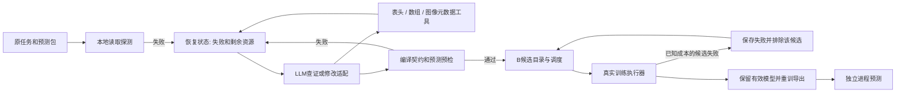

# SA19：从实际接入失败恢复到训练和独立预测

本批完成A线最小恢复控制器及结构工具，三个预登记可恢复条件全部无人干预交付。不是“所有未知任务均可完成”的证明，也没有测准确率提升。

## 瓶颈 → 结构 → 实验 → 证据边界

| 瓶颈 | 结构改动 | 实际实验 | 支持到哪一步 |
|---|---|---|---|
| 本地读入或预测适配失败就退出 | 正式入口传同一个RecoveryController；记录失败、已查证据、未决项、剩余请求/fit/时间、已有文件；语义循环使用原共享请求额度 | R1原始CSV预测字段改名，本地无LLM接入失败；真实Flash先查预测表头，再查训练表头，第三次提案编译映射、预检、训练、导出 | 这个开发条件完整交付；没有注入回复/适配/选模，不是随机政策收益消融 |
| NPZ内部键未知，模型只能猜 | inspect_array提供键、shape、dtype；inspect_image提供尺寸/模式，均不返回数组值或像素 | R2本地读取失败；真实Flash先后检查训练和预测NPZ，按文档“二维为输入、一维为目标”选择键，随后正式训练/预测 | NPZ自然工具闭环通过；图像工具本批只有无像素加载的结构检查，未新增真实图像恢复成绩 |
| 方法失败和接入状态分离 | 将失败状态接到B现有候选替换逻辑及规划payload；不另写方法排序器 | R3首个已选方法在worker启动前按协议抛一次RuntimeError；0次fit记给该故障，其他实际训练照常；随后转其他候选并交付 | 验证故障后的完整执行回归。该次Flash额度在故障前用完，故障后由已有本地规则恢复；不声称证明LLM看见训练故障后改善了选择，B既有能力不算A新增因果收益 |
| 为了不停机而猜错目标、假装完成 | 失败和未决目标持续保留，只有编译/预测预检通过才能训练；未决状态不记完整交付 | R4材料明确没有指定两个标注中哪个是目标；三次真实回复后保留target未决，无fit、无完整交付 | 错误完成0/1；这是缺信息对照，不能充当可恢复成功案例，也不代表任意歧义可自动判断 |

Python仍执行已安装的读取器、结构验证、训练与记账；数据含义和适配由LLM按原文及工具证据提出。单个动作失败不等于整条路径结束；传输失败不重试、总预算不增加。

## 真实运行数据

| 条件 | 结果 | 实际fit，含refit | Flash | 课程折算 | 秒 |
|---|---|---:|---:|---:|---:|
| R1 字段改名 | 完整交付；36行新进程一致 | 3 | 3 | ¥0.020397 | 94.094 |
| R2 NPZ键未知 | 完整交付；36行新进程一致 | 3 | 3 | ¥0.020211 | 103.969 |
| R3 方法启动故障 | 完整交付；36行新进程一致 | 3 | 3 | ¥0.023277 | 98.328 |
| R4 目标真的缺失 | 保留未决，未伪造目标 | 0 | 3 | ¥0.019757 | 76.063 |
| 总计 | 可恢复条件3/3，四条件错误完成0，运行中人工介入0 | 9 | 12 | **¥0.083642** | **372.515墙钟** |

R1/R2同原包本地接入对照0/2、LLM恢复2/2，比较的是完整接入，不是同训练预算的预测质量。三个成功条件的目标、指标、训练特征/标签指纹、预测特征指纹、输出规则九项检查均通过；3个模型独立进程预测共108行逐字节一致。所有条件是同一公开Wine来源的受控开发场景，不是三个独立未知任务；没有读取预测答案，没有新增外层评分。

独立审计4/4：12条真实响应与canonical ledger的请求ID、模型、token、费用逐项绑定，接受的契约对应真实回复；39054输入、11147输出token。原行SHA保留，累计485→497，known ¥8.129441→¥8.213083，unknown仍16、pending0。费用是课程折算，原16条未知保持null，学校实际总扣费及预算合规仍未核验。

## 检查与复跑

- 303/303无fit/无API回归，25.437秒；包含9项新增恢复/结构检查。另保留两项原B直接fit夹具的显式排除。可复跑scripts/run_sa19_recovery_checks.py。
- 首轮5个检查失败来自新增日志目录、旧夹具对两次退出/不作本地探测的假设、Mock预算属性及日志失败时点；修正夹具后最终通过。中间一轮脚本缩进错误也保留，均0fit/API。
- 首次live脚本把R1等大写拼进scope，四条均在预检前拒绝，0fit/API；小写修正后新注册、新目录运行，未重试任何已发HTTP请求。
- 冻结输入与oracle：research/sa19_recovery_prepared_02；实际运行：research/sa19_recovery_live_02；独立审计：research/sa19_recovery_audit_01。旧失败目录保留。
- 复跑：先`python -m scripts.run_sa19_recovery_live prepare --output <新目录> --checks <通过的检查目录>`，再用`run --prepared ... --output ... --private-output ... --ledger ... --key-file ... --accepted-history ... --scope <新小写scope>`；真实账本/密钥和数据包不进入Git，不允许重复原scope。

## 仍有的瓶颈，下一批按收益顺序处理

1. R1/R2各用了两次工具调用，耗尽三次Flash才完成接入，留给选模的LLM预算为0。应检验组合结构探查/显式子预算或一次多工具计划，保持总请求额度不变，测接入成功与留给B的资源，不能直接悄悄加请求数。
2. R4三个语义提案都指向同一缺失目标，没有新事实；原文JSON不同，字节签名未识别为同一语义空转。需要以未决字段及证据增量识别空转，并支持有证据的明确未决报告，避免继续花钱改写同一结论。
3. 当前恢复覆盖接入编译/预测预检和B的已知成本候选失败。ask内部JSON解析、损坏输入与真实文件IO的异常分类、最终预测阶段的修复仍需接入统一诊断；不能叫完整任意阶段恢复。
4. 尚未验证LLM看见训练故障后的选择收益，也未完成独立来源三模态未知包演练。保留本批版本为开发证据，先补真实范围再讨论冻结。

本批不主张省了多少实际API费用：相对无法完成的本地路径，这次是花少量费用获得可交付结果；新工具及恢复状态的额外成本已经实记，不能把假设性人工修复费用写成已节省费用。
