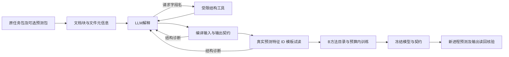

# SA3：主动理解、结构探查和训练前试读

2026-11-26，基线9258318，开发分支codex/a-semantic-adaptation-1126。本批完成结构实现与离线工程验收，未冻结发布版本，未改B的方法目录和排名。它不能代替真实Flash语义实验或完整未知任务验收。

## 瓶颈、结构与证据

| 瓶颈 | 本批结构 | 实验和结果 | 支持范围 |
|---|---|---|---|
| 本地能读文件就结束理解，忽略公告中的输出要求 | 显式`--task-interpretation proactive`，即使native读取成功也请求理解；默认fallback兼容 | 真实普通CSV包先被旧reader成功加载且没有output recipe，新路径编译公告指定的Decision列和Y/N映射 | 模拟回复证明接线；真实LLM正确解释率未测 |
| 模型不知道文件内部字段，容易一次猜错 | 有界`inspect_header`工具；训练与独立预测包可分别探查，回传codec/字段名 | 一次工具后提案；外部JSON的test集合可探查；私有ID和行值没有进入payload | 已安装record reader；不是任意二进制reader生成 |
| 训练完成才发现预测字段改名或ID缺失 | 冻结一对一`field_map`；任何fit前试读真实预测特征、原ID及样例顺序 | signal→sensor重放仍符合原signal模型schema；坏字段/缺ID先反馈并修复，正式`_train`到standby之前已通过；坏模板ID集提前失败 | 预测输入必须已提供或已在同包登记；未来未提供的输入无法提前验证 |
| 训练包与后来独立预测包被当成同一个文件目录 | 训练与预测成员分别校验，后者提供独立metadata索引 | 训练包不含later.data，独立预测包包含该成员，字段映射和ID检查通过 | 同包及显式`--prediction-input` |
| 语义修复、工具探查和算法规划可能各自多花预算 | 共用原client计数；最多两次工具/两次失败提案，且总数受原上限约束 | 工具→坏提案→修复最多3请求；上限2时不发生第3请求；连接失败不重试 | 这里的请求是模拟client，真实token/费用不是0的效果结论 |
| 模型解释覆盖已有明确输入契约 | 显式manifest保持输入、target、metric权威，只允许输出overlay | CSV及JSONL manifest均保留原target/accuracy；试图换输入契约被拒绝 | 不解决相互矛盾的manifest公告裁决 |
| 工程错误也触发多余调用，解析错误泄露数据值 | OSError不做语义重试；读库错误只提供结构诊断，输出错误可给固定诊断 | 磁盘写入失败只调用1次；PRIVATE_CELL数值转换失败不进入下一条payload | 不把库原始异常当公开提示；API原异常仍直接传播 |

新测试27项，连同前两批及相关回归共**100项通过**。正式runner最终回执：**10.312秒、0分类器拟合、0真实模型API、¥0新增课程费用**。禁止Executor.worker与父进程联网；上一批独立CLI只重载固定算术模型，不训练。solve子进程传参由mock检查，不冒充真实自主训练完成。

## 数据流



工具/修复箭头都受同一个原有请求上限约束。Python负责真实解码、角色隔离、计算、预算和输出核验；LLM解释公告并提出可执行的适配，不生成分类预测。存在引用仅证明来源存在，不证明语义一定正确。

## 首轮失败与复跑

计划与runner先落盘。`research/sa3_proactive_probe_attempt1`保留94项首轮：1失败、2错误，原因分别是新增拒绝条件顺序改变旧诊断、测试夹具未创建日志目录、测试用系统编码读含中文路径的UTF-8 JSON。修正后v2为97/97；为覆盖声明JSONL和集合角色探查又补测试，v3为98/98，最终100/100。未覆盖旧目录或删除失败回执。

- 最终协议、逐测试日志与回执：`research/sa3_proactive_probe_final/`。
- 生产源及本批runner/测试SHA已登记在protocol.json，运行前后相同。
- 本批未触碰真实API账本、数据资产、模型权重和课程正式测试。

复跑（在本分支根目录，输出目录必须全新）：

```powershell
& 'D:\codex\python_withai\runs\a79_encoder_assets\venv\Scripts\python.exe' -m scripts.run_sa3_proactive_probe --output research/sa3_replay_NEW
```

正式入口已支持以下参数组合，但本批没有执行这个训练命令；proactive需要既有配置的真实client，不能把未配置客户端或初始化失败算成LLM组：

```powershell
python unified_agent.py solve TRAIN.zip --prediction-input QUERY.zip --run-dir runs/NEW --output runs/NEW/predictions.csv --task-interpretation proactive --fit-limit 10 --time-limit 1200
```

## 当前阶段和下一步

四天计划仍在D1/D2：SA1全局契约、SA2输出、SA3主动解释/工具/前置试读的开发闭环已接通，**真实LLM成功率、独立保留案例、三模态真实自主运行尚未完成**，不按测试数量宣布四天计划完成。

下一批先固定语义案例和独立oracle，再做预登记的小规模真实Flash机制探测；每条请求/失败都登记并保留。沿用真实团队账本，不用空账本掩盖历史，也不以历史未知要求用户再查官网。先核对B待并账调用与实际部署接线，不能仅凭环境变量存在宣称能运行。真实理解通过后才安排三模态训练对照，0fit工具测试不能替代它。

当前限制：主动全量计划主要面向已有标量record reader；原生图像/数组的无manifest语义适配未补齐。无损header探查仍通过本地reader读取所选成员，发送模型的仅结构；不声称只在磁盘读了第一行。shared-table被投影后若丢失原ID，原生ID路径会明确失败，本批未承诺恢复。预测期才出现的新映射目前需预先登记，尚无冻结模型之后的独立LLM修复入口。未实现任意join、插件生成或新指标公式。
