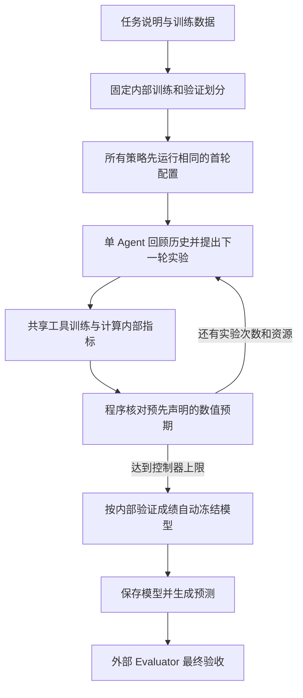

# 会回顾实验结果的单 Agent 设计

这个 Agent 每次训练前先说明“本轮想验证什么”，训练后由程序核对“是否达到预期”，再把记录交给同一个 Agent 安排下一轮。它接入现有共享训练工具，第一版使用现有 14 个配置，最多尝试 3 次。要检验的研究问题是：这种实验记录和反馈方式，能否帮助有限次数的搜索。

## 决策流程

第一轮是共用参照，占用三次机会中的一次。后两轮每轮只调用一次 LLM，由它同时完成简短回顾、假设和配置选择。控制器负责次数、超时和费用保护，并按内部验证 Accuracy 选模型，同分按配置 ID 排序。正式测试成绩不进入决策过程。

## Agent 每轮看到什么

它看到训练数据的概况、尚未尝试的配置、剩余次数、之前提出的实验方案，以及已完成实验的训练成绩、内部验证成绩、两者差距、耗时和失败信息。前一轮的预期核对结果也会进入下一轮记忆。

不向 Planner 传入任务名称、文件路径、官方验证分数或测试标签。官方验证只在最终模型冻结后评分；它是开发评估数据，已经参与过早期开发时，不能称为全新的留出测试。

## Agent 每轮提交什么

| 字段 | 含义 |
| --- | --- |
| candidate | 选择一个尚未尝试的合法配置 |
| reason | 简短说明选择依据 |
| hypothesis | 本轮想检验的一个想法 |
| review | 对之前结果及预期核对的简短解读 |
| evidence_trials | 引用的已有实验编号；不能编造未来实验 |
| expected_change | 一个可数值核对的相对预期；没有参照时可为空 |

例如，Agent 观察到训练成绩高于内部验证成绩，提出：“更强的正则化可能改善验证表现。”它选择一个合法配置，并在训练前声明：相对实验 1，内部验证 Accuracy 至少增加 0.01，也就是一个百分点。

程序会把实际差值与这个预期比较，记录为“达到预期”“未达到预期”“无法核对”或“未声明预期”。超时、训练失败或缺少指标不会被记成成功。Agent 下一轮可以据此更新判断。

这只说明本次测量有没有达到预期，不能单凭它证明“之前一定过拟合”。预期命中次数也不作为自主能力总分；容易实现的预期不能替代模型表现和交付能力。

## 和组员现有系统怎么接

- `HypothesisAgent.choose(profile, history, available)` 保留现有 Planner 的调用方式。
- 继续调用现有数据读取、分组划分、候选配置和训练子进程。
- 新的 `proposal` 与 `hypothesis_check` 随实验结果保存到 `trials.json`，供后续决策及 Evaluator 审查。
- `final_selection.json` 与 `task_spec.json` 描述冻结方案，原有 `predict` 命令可读取新的模型包。
- 由外部 Evaluator 验收指定指标、预测格式、费用和模型可复现性；该评测器仍按团队的统一合同接入。

本轮的实验状态只属于当前任务的一次运行，不跨任务传递成绩，也不根据数据集名称调用预设方案。

## 第一组对照实验

| 策略 | 每轮输入 | 回答的问题 |
| --- | --- | --- |
| 原有 feedback | 现有历史结果输入 | 现有实现的参照表现 |
| reflective | 历史结果、之前的实验方案、预期核对记录 | 整体结构化反馈设计是否有效 |
| reflective_no_feedback | 自己先前提出的方案；隐藏成绩、错误和核对结果 | 在相同设计中，观测实验结果是否有帮助 |

无反馈版必须从头独立运行，不能把有反馈版的历史轨迹遮住部分字段后重放，因为旧的方案文字可能已经包含成绩信息。

所有策略使用相同的首轮配置、14 个候选、内部划分、最大 3 次训练尝试和训练超时。分类器种子保留原实现的 42。两个新增策略在首轮成功并完成全部轮次时，各有 2 次 LLM 决策调用；失败或截止时间到达时可能更少。

先用一个任务和一个固定 seed 演练。确认运行、用量与导出有效后，再预先固定重复次数，增加未参与调试的数据集。记录最终验证成绩、完成率、搜索轨迹、耗时、实际 Token、已知或未知用量状态和费用。等调用次数或等额度并不保证实际 Token 相同，要同时报告真实消耗。一次 Pilot 不用于宣称架构胜出。

`--per-run-budget-rmb` 给每次 LLM 运行相同的课程核算额度，并要求所有额度之和事先放得进批次上限。某次未用完的额度不会提高另一次的上限。任何一次出现用量不明或实际用量超估，整个批次停止新的 API 请求；恢复产生的结果标记为非纯策略运行，不能混入纯策略平均成绩。

## 这版的验收

1. 方案在训练前落日志，训练结果产生后才核对预期。
2. 后续决策能收到前一轮结果及核对记录；无反馈版收到的观测列表为空。
3. 非法配置、未来实验引用和不合法数值被拒绝，降级运行如实标记。
4. 模型冻结后可在新进程重新加载，输出正确行数的预测；预测路径不加载测试标签。
5. 完整保留一次自主运行需要的方案、指标、决定、模型与调用记录。

当前离线示例用脚本代替 LLM，真实执行训练和预测，验证上述接口。真实 LLM 是否合理回顾、是否受反馈影响、是否提高搜索表现，是下一阶段 Pilot 的验收内容。

## 正式实验前的条件

按用户更新的口径，DeepSeek 课程费用统一使用更新后的官方空闲时段价，不受实际调用时间影响，也不采用缓存、平台优惠或免费额度折扣。v0.1.1 已冻结 2026 年 11 月 16 日核对的官方价格：Pro 输入/输出为每百万 Token ¥4.5/¥13.5，Flash 为 ¥1/¥4；模型发布日期仍须符合 2026 年 10 月 21 日的截止要求。日志分别记录课程费用和平台实际费用，平台扣款未经对账时记为未知。来源和规则见[计费说明](deepseek_pricing.md)。调用前 Token 预估不是已认证的严格计费上界，跨进程恢复的账本仍需统一接入。

当前候选、输入格式和内部评分沿用两类任务的二分类 Accuracy 实现。通用文本、混合表格、多分类、图像、任务指定指标及提交 ID 格式，需要通过共享 TaskSpec 和工具层逐步扩展。新增决策层本身不代表这些能力已经完成。

基线来源：[团队仓库 68e6772](https://github.com/limukun6/python_withai_superagent/tree/68e6772daa9ced52849c16ab694fefb88029a860)。这一版是可供接入和评测的设计原型，不是最终冻结提交。
